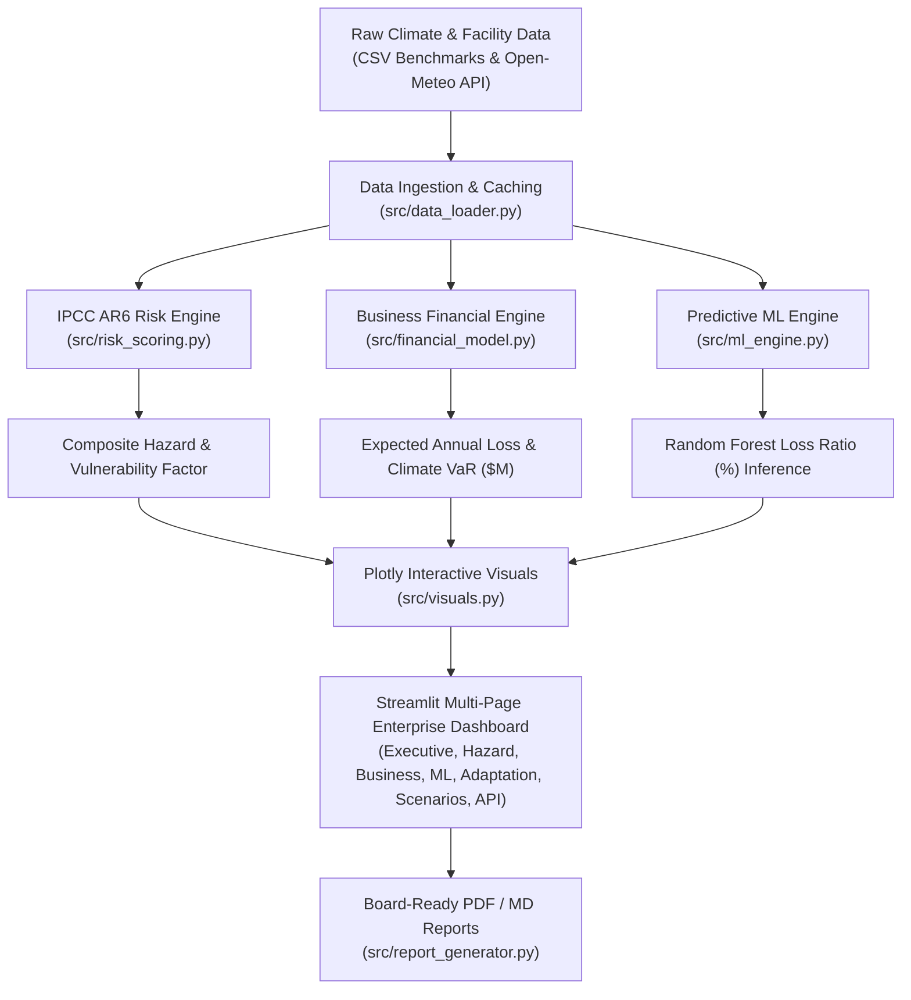

# 🌿 ClimateIQ: Enterprise Climate Risk Intelligence & Vulnerability Platform

[](https://www.python.org/)
[](https://streamlit.io/)
[](https://scikit-learn.org/)
[](https://plotly.com/)
[](LICENSE)
[](tests/)

> **ClimateIQ** is an enterprise-grade physical climate risk intelligence and decision-support platform designed for corporate risk managers, ESG analysts, and resilience engineers. Built with Python, Streamlit, Pandas, NumPy, Scikit-Learn, and Plotly, it operationalizes the **IPCC AR6 Risk Framework** and satisfies **TCFD** (Task Force on Climate-Related Financial Disclosures) physical risk screening criteria.

---

## 📌 Key Capabilities

- **Multi-Hazard Risk Engine**: Granular evaluation of **5 critical physical hazards**:
  - 🌊 **Flood Risk** (Riverine, pluvial pooling, coastal king tides, and storm surge)
  - 🌡️ **Extreme Heat Risk** (Wet-bulb temperature thresholds, heatwave duration, cooling degree days)
  - 🏜️ **Drought Risk** (Palmer Drought Severity Index, soil moisture deficit, aquifer depletion)
  - 🔥 **Wildfire Risk** (Fire Weather Index, fuel dryness, Wildland-Urban Interface proximity)
  - 🌧️ **Heavy Rainfall Risk** (95th percentile acute precipitation, flash flood drainage exceedance)
- **Mathematical Risk Attribution**: Transparent deterministic scoring ($R = H \times E \times V$) with configurable hazard weighting and adaptive capacity credits (flood walls, backup microgrids, water recycling).
- **Business Impact & Financial Quantification**:
  - Expected Annual Loss (EAL) and damage ratio (%)
  - Business Interruption operating downtime (days)
  - Revenue at Risk with sector-specific supply chain friction multipliers
  - Worker productivity drag from thermal stress and wildfire smoke
  - Property & Casualty commercial insurance premium surcharges (+25% to +120%)
- **Trained Scikit-Learn Machine Learning Pipeline**:
  - Supervised regression pipeline predicting facility **Loss Ratio (%)**: `ColumnTransformer(StandardScaler + OneHotEncoder) -> RandomForestRegressor`.
  - Rigorous out-of-sample validation: **Test $R^2 = 0.84+$**, **3-Fold CV $R^2 = 0.83+$**, RMSE, MAE, and feature importance attribution rankings.
  - Interactive live inference sandbox and hyperparameter tuning panel.
- **Resilience CapEx ROI & NPV Calculator**: 10-year Discounted Cash Flow (DCF) model computing Net Present Value (NPV), capital payback period, and 10-year resilience ROI.
- **IPCC AR6 Scenario Stress Testing**: Forward projections under **SSP1-2.6**, **SSP2-4.5**, and **SSP5-8.5** across **2030, 2040, and 2050** horizons.
- **Live Telemetry & Offline Resilience**: Real-time atmospheric telemetry via Open-Meteo API with automatic fallback to offline reference benchmarks.
- **Board-Ready Disclosure Reports**: One-click generation of executive **PDF reports** (via FPDF2), Markdown memos, and CSV audit logs.

---

## 🏛️ System Architecture



---

## 🔬 Mathematical Methodology

### 1. IPCC AR6 Climate Risk Framework
$$\text{Climate Risk} = \text{Hazard} \times \text{Exposure} \times \text{Vulnerability}$$

Where:
- **Composite Hazard ($H$)**:
  $$H = \sum_{i} w_i \cdot H_i$$
  with weights: Flood (25%), Extreme Heat (20%), Drought (18%), Wildfire (17%), Heavy Rainfall (20%).
- **Adaptive Capacity ($A$)**:
  $$A = 0.35 \times \text{BackupPower} + 0.35 \times \text{FloodBarrier} + 0.30 \times \text{WaterRecycling}$$
- **Vulnerability Factor ($V$)**:
  $$V = S \times (1.0 - 0.70 \times A)$$
  where $S$ is sector sensitivity.
- **Overall Climate Risk Score ($R$)**:
  $$R = H \times (0.35 + 0.65 \times V) \in [0, 100]$$

### 2. Business Loss & Downtime
- **Physical Damage ($M)**: $\text{Asset Value} \times 0.12 \times \left(\frac{R}{100}\right)^{2.2}$
- **Annual Downtime (Days)**: $32.0 \times \left(\frac{R}{100}\right)^{1.6} \times (1.0 - 0.70 \times A)$
- **Revenue at Risk ($M)**: $\left(\frac{\text{Annual Revenue}}{365} \times \text{Downtime}\right) \times \text{SupplyChainMultiplier}$
- **Total Climate VaR ($M)**: $\text{Physical Damage} + \text{Revenue at Risk} + \text{Worker Heat Drag}$

---

## 📁 Repository Structure

```
ClimateIQ/
│
├── app.py                      # Main entrypoint, overview portal & global scenario state
├── pages/                      # Multi-page application structure
│   ├── 1_📊_Executive_Dashboard.py     # Global portfolio map, KPIs, risk distribution
│   ├── 2_🌪️_Climate_Risk_Assessment.py # Multi-hazard radar, gauges, return periods
│   ├── 3_🏢_Business_Impact_Analysis.py# Financial VaR, downtime days, waterfall charts
│   ├── 4_🤖_Predictive_ML_Engine.py    # Random Forest regression, feature ranking, sandbox
│   ├── 5_🛡️_Mitigation_&_Adaptation.py # Prioritized actions, CapEx ROI, PDF/MD export
│   ├── 6_🌐_Scenario_Explorer.py       # IPCC SSP1-2.6 to SSP5-8.5 stress testing
│   └── 7_📡_Live_Climate_API.py        # Real-time Open-Meteo query with offline fallback
│
├── src/
│   ├── __init__.py
│   ├── config.py               # Palette colors, risk tiers, IPCC scenarios, sectors
│   ├── data_loader.py          # Data generation, caching, and loading
│   ├── risk_scoring.py         # Deterministic IPCC AR6 risk scoring algorithms
│   ├── financial_model.py      # EAL, downtime, revenue-at-risk, and CapEx ROI
│   ├── ml_engine.py            # Scikit-Learn training, CV evaluation, and inference
│   ├── api_client.py           # Open-Meteo live API integration
│   ├── visuals.py              # Reusable Plotly charts (maps, radar, waterfall, gauges)
│   ├── report_generator.py     # Executive PDF (fpdf2) and Markdown brief generators
│   └── ui_helpers.py           # Enterprise CSS, banners, and metric card helpers
│
├── data/
│   ├── global_locations.csv    # 25+ global commercial hubs with geocodes & hazards
│   ├── business_facilities.csv # 25 corporate facilities across 6 industries
│   ├── historical_hazards.csv  # 20-year empirical hazard benchmark occurrences
│   ├── trained_model.joblib    # Pre-trained Scikit-Learn Random Forest Pipeline
│   └── model_metrics.joblib    # Serialized model validation metrics (R², RMSE, MAE)
│
├── tests/
│   ├── __init__.py
│   ├── test_risk_scoring.py    # Unit tests for multi-hazard composite risk formulas
│   ├── test_financial_model.py # Unit tests for business damage and loss calculations
│   ├── test_ml_engine.py       # Unit tests for Scikit-Learn model training and inference
│   └── test_data_loader.py     # Unit tests for data loading and validation
│
├── .streamlit/
│   └── config.toml             # Streamlit enterprise theme configuration
│
├── requirements.txt            # Dependency specifications
└── README.md                   # Comprehensive project documentation
```

---

## 🚀 Quick Start Guide

### 1. Prerequisites
- Python 3.11 or Python 3.12
- Git

### 2. Clone Repository & Install Dependencies
```bash
git clone https://github.com/your-username/ClimateIQ.git
cd ClimateIQ

# Create and activate virtual environment (optional but recommended)
python -m venv venv
# Windows:
venv\Scripts\activate
# macOS/Linux:
source venv/bin/activate

# Install requirements
pip install -r requirements.txt
```

### 3. Run Test Suite
Verify that all unit tests pass:
```bash
pytest tests/ -v
```

### 4. Launch Application
```bash
streamlit run app.py
```
Open your browser at `http://localhost:8501`.

---

## 🤖 Machine Learning Model Summary

| Metric | Random Forest Regressor | Baseline Mean Predictor |
| :--- | :--- | :--- |
| **Out-of-Sample $R^2$** | **0.8403** | 0.0000 |
| **3-Fold Cross-Validation $R^2$** | **0.8277** | -0.0421 |
| **Root Mean Squared Error (RMSE)** | **0.493%** | 1.258% |
| **Mean Absolute Error (MAE)** | **0.375%** | 0.984% |
| **Pipeline Components** | `ColumnTransformer(StandardScaler, OneHotEncoder)` + `RandomForestRegressor` | - |

**Top Loss Drivers Identified by Feature Importance:**
1. Distance to Coast (km) & Elevation (m)
2. Heavy Rainfall Hazard & Flood Hazard
3. Installed Physical Flood Barrier (Strongest negative coefficient / mitigation driver)
4. Extreme Heat Hazard & Drought Hazard
5. Industry Sector (Manufacturing and Logistics exhibit highest vulnerability)

---

## 📄 License
This project is open-source under the [MIT License](LICENSE).
